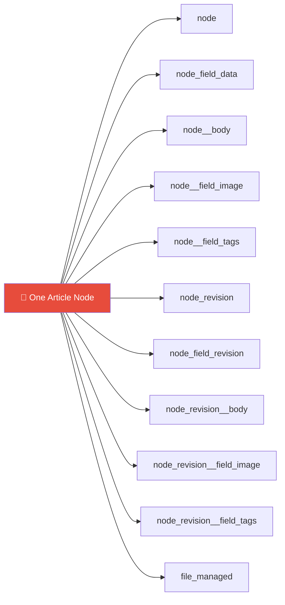
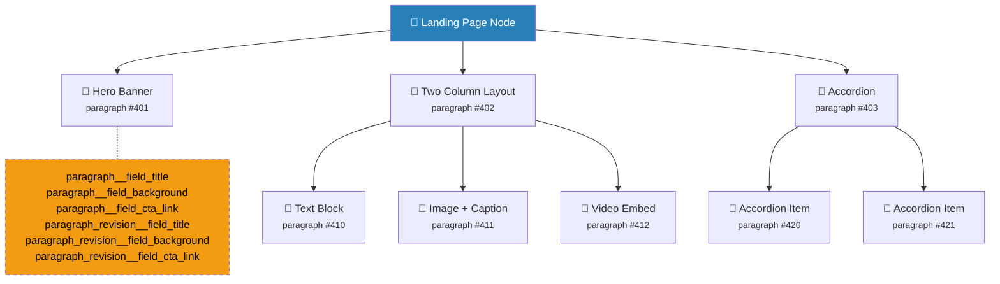
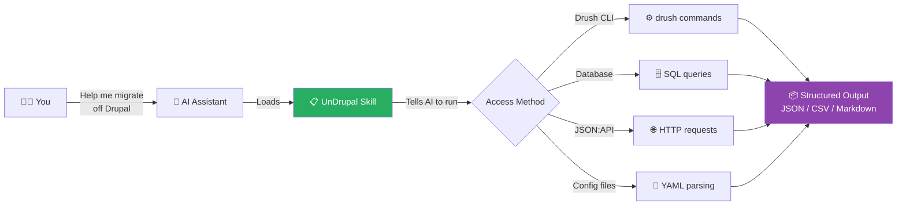

<p align="center">
  
</p>

<h3 align="center">Get your content out of Drupal.</h3>

<p align="center">
  AI agent skills that make your coding assistant competent at extracting content, configuration, and structure from Drupal 7 through 11.
</p>

---

## Why This Exists

Drupal has a Migrate API. It moves content **into** Drupal. There is no `drush content:export-to-json`. No "Export Site" button. No official path out.

You want your content back? You reverse-engineer the CMS internals: an entity-attribute-value database with hundreds (often thousands) of tables, serialized PHP blobs, recursive entity reference chains, and rich text fields laced with Drupal-only tokens. Most AI assistants struggle with this. UnDrupal teaches them.

### The Missing Export

Drupal's Migrate API is one-way. Other CMSes hand you your data. WordPress? `SELECT * FROM wp_posts`. Drupal? This is what you write to extract **one article** with a title, body, image, and two tags:

```sql
SELECT n.nid, nfd.title, nfd.status, nfd.created,
       nb.body_value, nb.body_format,
       ni.field_image_target_id,
       fm.uri AS image_uri, fm.filename,
       GROUP_CONCAT(nt.field_tags_target_id) AS tag_ids
FROM node n
JOIN node_field_data nfd ON n.nid = nfd.nid AND nfd.langcode = 'en'
LEFT JOIN node__body nb ON n.nid = nb.entity_id AND nb.langcode = 'en'
LEFT JOIN node__field_image ni ON n.nid = ni.entity_id AND ni.langcode = 'en'
LEFT JOIN file_managed fm ON ni.field_image_target_id = fm.fid
LEFT JOIN node__field_tags nt ON n.nid = nt.entity_id AND nt.langcode = 'en'
WHERE n.nid = 42
GROUP BY n.nid;
```

That query covers a content type with 3 fields. A real content type with 15 fields, entity references, paragraphs, and media needs 20+ JOINs, subqueries for multi-value fields, and recursive resolution for nested paragraphs.

### The EAV (Entity-Attribute-Value) Tables

Drupal scatters each field across its own table, then duplicates the whole structure for revisions.



One article with three fields touches twelve tables. Add 20 fields to a content type and you get 40+ field tables. Medium Drupal sites have 500–800 database tables. Large enterprise sites cross 1,000.

| CMS | Tables for "all articles" | Query complexity |
|-----|--------------------------|-----------------|
| WordPress | 2 (`wp_posts` + `wp_postmeta`) | One query |
| Strapi | 1 per content type | One query |
| Drupal | 2 + (2 × number of fields) | Multi-JOIN monster |

### Serialized PHP

You can't read parts of your own Drupal database without a PHP runtime.

| Where | What's Serialized |
|-------|-------------------|
| Layout Builder | Literal PHP `Section` and `SectionComponent` objects |
| `key_value` table | Entity definitions, schema info, state data |
| `config` table (D8+) | All site configuration |
| `variable` table (D7) | All site settings |
| `cache_*` tables | Cached render arrays, plugin definitions |
| Webform submissions | YAML-serialized form data |

Layout Builder is the worst case. Your page layouts sit in `node__layout_builder__layout` as serialized PHP objects. Not JSON. Not YAML. PHP objects that need Drupal's class autoloader to deserialize.

### Paragraph Nesting 

The Paragraphs module (used on hundreds of thousands of sites) stores each component as a separate entity in separate tables with separate revision tables. The structures are recursive.



A site with 12 paragraph types and 5 fields each generates 120 paragraph field tables. Exporting one landing page means you walk the entire tree, following entity references through multiple table layers. No Drupal API gives you this as portable JSON.

### Rich Text 

Drupal body fields look like HTML but contain Drupal-specific tokens that break outside the CMS:

```html
<!-- D8/D9/D10/D11: Media embed -->
<drupal-media data-entity-type="media"
  data-entity-uuid="2b18308c-41a0-4d72-8c84-7d3e1a08acf2"
  data-view-mode="full"></drupal-media>

<!-- Linkit module references -->
<a data-entity-type="node"
   data-entity-uuid="f3a7c4e2-..."
   href="/node/42">Click here</a>

<!-- D7 Media module tokens -->
[[{"type":"media","view_mode":"media_large","fid":"123",
   "attributes":{"class":"media-image"}}]]
```

Export these body fields raw and your visitors see broken images, dead links, and raw tokens. You need to resolve each one to an actual URL or embedded content before the data works anywhere else.


### Revision Table Bloat

Drupal keeps every revision of every field by default. No built-in cleanup.

> 20 fields × 50 revisions = **1,000 rows for one node**

A site with 10,000 nodes and active editorial workflows accumulates **millions** of revision rows across hundreds of tables. Export queries slow to a crawl, data volumes balloon, and figuring out which revision is canonical takes work.

---

## What UnDrupal Does



UnDrupal is a set of markdown skill files. Each one teaches an AI coding assistant how to audit, extract, or plan one piece of a Drupal migration. The AI loads a skill, reads the instructions, then runs the commands, SQL queries, and API calls described in it.

Each skill documents multiple access methods so the AI picks the right one for your situation:

| Access Method | Requires | Best For |
|---------------|----------|----------|
| Drush / CLI | Shell access to the server | Full audit, config export, content export |
| Direct database | MySQL/PostgreSQL credentials | Bulk content export, complex joins |
| JSON:API | HTTP access to the site | Remote extraction, no server access needed |
| GraphQL | GraphQL module enabled | Deeply nested data, decoupled sites |
| Config file parsing | Access to config sync directory | Structure-only analysis |
| Site crawling | A public URL | Last resort when nothing else is available |

---

## Supported AI Tools

| Tool | How It Loads |
|------|-------------|
| Claude Code | Copy to project root. `CLAUDE.md` auto-loads. |
| Cursor | Copy to project root. `.cursor/rules/` auto-loads. |
| Windsurf | Copy to project root. `.windsurfrules` auto-loads. |
| pi | Copy to project root. `AGENTS.md` auto-loads. |
| Aider | Add `read: AGENTS.md` to `.aider.conf.yml` |
| GitHub Copilot | Reference `AGENTS.md` in workspace instructions. |
| Any other tool | Point it at `AGENTS.md`. |

## Quick Start

```bash
# From your Drupal project root
git clone https://github.com/saitanay/unDrupal.git .unDrupal

# Copy everything into your project
cp -r .unDrupal/skills .
cp -r .unDrupal/scripts .
cp -r .unDrupal/reference .
cp -r .unDrupal/templates .
cp .unDrupal/AGENTS.md .
cp .unDrupal/CLAUDE.md .
cp -r .unDrupal/.cursor .
cp .unDrupal/.windsurfrules .
```

Or add UnDrupal as a git submodule and symlink the adapter files:

```bash
git submodule add https://github.com/saitanay/unDrupal.git .unDrupal
ln -s .unDrupal/skills skills
ln -s .unDrupal/scripts scripts
ln -s .unDrupal/reference reference
ln -s .unDrupal/templates templates
ln -s .unDrupal/AGENTS.md AGENTS.md
ln -s .unDrupal/CLAUDE.md CLAUDE.md
ln -s .unDrupal/.windsurfrules .windsurfrules
cp -r .unDrupal/.cursor .cursor
```

Then tell your AI assistant:

> "Audit this Drupal site and tell me what we're dealing with."

The AI loads the quickstart skill, checks what access methods are available, and builds a skill execution plan for your site.

---

## What It Covers

### 🔍 Discovery & Audit

Start here. Assess the site, map the content model, inventory the modules.

- **Quickstart** -- Decision tree that determines your Drupal version, access methods, target platform, and which skills to run in what order (`skills/00-quickstart.md`)
- **Site Audit** -- Content counts, module list, database size, multilingual status, commerce detection, page builder detection, multisite detection, hosting platform identification (`skills/01-site-audit.md`)
- **Content Model Map** -- Reverse-engineers every entity type, bundle, field, and relationship into a complete schema. Covers Field Collections (D7) and Layout Paragraphs (`skills/02-content-model-map.md`)
- **Module Inventory** -- Catalogs all enabled modules, classifies migration impact, suggests target-platform equivalents (`skills/03-module-inventory.md`)

### ⚙️ Configuration Export

Content types, views, display settings, text formats, image processing, workflows, permissions.

- **Content Types & Fields** -- Field storage, field instances, widget and formatter settings (`skills/04-content-types-fields.md`)
- **Views** -- Converts Views config into abstract query definitions usable outside Drupal (`skills/05-views-export.md`)
- **Display Modes** -- View modes, form modes, field groups, per-bundle display settings (`skills/06-display-modes.md`)
- **Text Formats & Editors** -- Text format definitions, input filter chains, CKEditor toolbar config (`skills/07-text-formats-editors.md`)
- **Image Styles** -- Image style pipelines and responsive image configuration (`skills/08-image-styles.md`)
- **Workflows & Moderation** -- Editorial workflow definitions, moderation states, transition rules, Workspaces (`skills/09-workflows-moderation.md`)
- **Roles & Permissions** -- Roles, permission grants, access control patterns (`skills/10-roles-permissions.md`)

### 📄 Content Export

Nodes, paragraphs, taxonomy, media, menus, blocks, users, comments, webforms.

- **Nodes / Content** -- All node content across all content types with full field data (`skills/11-nodes-content.md`)
- **Paragraphs** -- Resolves nested paragraph entity trees into flat, portable structures. Covers Field Collections (D7) and Layout Paragraphs (`skills/12-paragraphs-deep.md`)
- **Taxonomy** -- Vocabularies, terms, hierarchy, term-to-content relationships (`skills/13-taxonomy-export.md`)
- **Media & Files** -- Media entities, file metadata, actual file downloads (`skills/14-media-files.md`)
- **Menus & Navigation** -- Menu structures, menu link trees, breadcrumb config (`skills/15-menu-navigation.md`)
- **Blocks & Layouts** -- Custom blocks, block placements, Layout Builder overrides, Single Directory Components (`skills/16-blocks-layouts.md`)
- **Users & Profiles** -- User accounts, profile fields, role assignments (`skills/17-users-profiles.md`)
- **Comments** -- Full threading hierarchy preserved (`skills/18-comments.md`)
- **Webforms** -- Form definitions and submission data (`skills/19-webforms.md`)

### 🧩 Page Builders

Drupal has five page building approaches. Each stores data differently. Each needs its own extraction strategy.

- **Experience Builder (XB)** -- Drupal 11's canvas page builder. Component trees with props and slots, SDC integration (`skills/33-experience-builder.md`)
- **Site Studio / Cohesion** -- Acquia's visual builder. JSON layout blobs, component definitions, style guide tokens (`skills/34-site-studio.md`)
- **Gutenberg for Drupal** -- WordPress block editor ported to Drupal. Serialized HTML with `<!-- wp:block -->` comment delimiters (`skills/35-gutenberg-drupal.md`)
- **Paragraphs** -- See Content Export above (`skills/12-paragraphs-deep.md`)
- **Layout Builder** -- See Blocks & Layouts above (`skills/16-blocks-layouts.md`)

### 🏗️ Structure & SEO

URL structure, redirects, metatags, rich text cleanup.

- **URL Aliases & Redirects** -- Path aliases, redirect rules, pathauto patterns (`skills/20-url-aliases-redirects.md`)
- **Metatags & SEO** -- Metatag defaults, per-entity overrides, Open Graph, structured data (`skills/21-metatags-seo.md`)
- **Rich Text Cleanup** -- Finds and converts embedded media tokens, linkit references, Drupal-specific markup (`skills/26-rich-text-cleanup.md`)

### 🛒 Specialized

Commerce, multilingual, search, custom entities, revision history, scheduled content, flags.

- **Multilingual** -- Content translations, config translations, UI string translations (`skills/22-multilingual.md`)
- **Commerce** -- Products, variations, orders, payment config, stores, promotions (`skills/23-commerce.md`)
- **Search Indexes** -- Search API configuration, index definitions, Solr/Elasticsearch mappings (`skills/24-search-indexes.md`)
- **Custom Entities** -- Discovers and exports custom entity types from contrib or custom modules (`skills/25-custom-entities.md`)
- **Revision History** -- Node revision chains with timestamps, authors, log messages (`skills/27-revision-history.md`)
- **Scheduled Content** -- Scheduled publish/unpublish dates from Scheduler module (`skills/28-scheduled-content.md`)
- **Flags & Bookmarks** -- User-flagged and bookmarked content relationships (`skills/29-flags-bookmarks.md`)

### 🌐 Platform & Multisite

Multi-site setups, hosting platforms, domain management.

- **Multisite & Platform Architecture** -- Drupal multisite, Acquia Site Factory, Domain Access, Pantheon, Platform.sh, Lagoon. Migration scoping for multi-site environments (`skills/36-multisite-platform.md`)

### 📋 Synthesis

Migration plan, validation, content inventory.

- **Migration Plan Generator** -- Full migration plan document with scope, phases, risk assessment, timeline (`skills/30-migration-plan.md`)
- **Validation Checklist** -- Post-migration verification with source-vs-target count comparisons (`skills/31-validation-checklist.md`)
- **Content Inventory** -- Content inventory spreadsheet covering type, status, URL, last modified for each piece of content (`skills/32-content-inventory.md`)

---

## Scripts & Templates

UnDrupal includes ready-to-run scripts and templates alongside the skill files:

```
scripts/
├── drush/              # Shell scripts wrapping Drush commands
│   ├── audit-site.sh
│   ├── export-config.sh
│   ├── export-content-types.sh
│   ├── export-views.sh
│   ├── export-taxonomies.sh
│   ├── export-menus.sh
│   ├── export-aliases.sh
│   ├── export-redirects.sh
│   ├── export-users.sh
│   ├── export-blocks.sh
│   ├── export-media-manifest.sh
│   ├── export-metatags.sh
│   ├── export-workflows.sh
│   └── download-files.sh
│
├── jsonapi/            # Python scripts for remote extraction via JSON:API
│   ├── crawl-all-content.py
│   ├── resolve-includes.py
│   ├── discover-resources.py
│   └── download-files.py
│
├── db/                 # Raw SQL for direct database extraction
│   ├── schema-discover.sql
│   ├── export-nodes.sql
│   ├── export-paragraphs.sql
│   ├── export-taxonomy.sql
│   ├── export-media-files.sql
│   ├── export-menus.sql
│   ├── export-aliases.sql
│   ├── export-redirects.sql
│   ├── export-users.sql
│   ├── export-comments.sql
│   ├── export-revisions.sql
│   └── export-commerce.sql
│
└── transform/          # Post-export transformation scripts
    ├── flatten-paragraphs.py
    ├── resolve-entity-refs.py
    ├── views-to-query.py
    ├── clean-rich-text.py
    ├── normalize-content.py
    ├── generate-redirects.py
    └── validate-export.py
```

```
reference/                          # Baked-in Drupal knowledge the AI can consult
├── drupal-schema.md                # Database schema reference
├── drupal-entity-types.md          # All entity types and their tables
├── drupal-field-types.md           # Every field type and storage pattern
├── drupal-paragraph-patterns.md    # Paragraph nesting patterns
├── jsonapi-patterns.md             # JSON:API endpoint patterns
├── graphql-patterns.md             # GraphQL query patterns (v3/v4/v5)
├── drupal-rich-text.md             # Text formats, filters, embedded media tokens
├── common-contrib-modules.md       # Data patterns for major contrib modules
└── d7-vs-d9-differences.md         # Schema differences between major versions
```

The `reference/` directory is the differentiator. These files contain Drupal schema knowledge, field type storage patterns, and version-specific differences that most AI models don't carry in their training data. The skills reference these files so the AI doesn't guess at table names or entity structures.

---

## Target Platform Mappings

Each mapping guide in `templates/target-mappings/` tells the AI how to transform Drupal exports for the target platform:

| Target | Guide | Covers |
|--------|-------|--------|
| WordPress | `to-wordpress.md` | Post types, ACF/meta fields, taxonomy, media library, redirects |
| Next.js + Sanity | `to-nextjs-sanity.md` | Sanity schemas, GROQ queries, image pipeline, structured content |
| Next.js + Contentful | `to-nextjs-contentful.md` | Content models, rich text, asset management, locales |
| Payload CMS | `to-payload-cms.md` | Collections, field configs, access control, rich text (Slate/Lexical) |
| Strapi | `to-strapi.md` | Content types, components, dynamic zones, media library, i18n |
| Astro | `to-astro.md` | Content collections, MDX conversion, image optimization, routing |
| Hugo | `to-hugo.md` | Front matter, content organization, taxonomy, shortcodes |
| 11ty | `to-11ty.md` | Data cascade, collections, Nunjucks templates, pagination |
| Custom App | `to-custom-app.md` | Generic JSON export, schema design, API structure, file handling |

---

## Example Session

```
You: I need to migrate this Drupal 10 site to Next.js with Sanity. I have Drush access.

AI: Loading quickstart skill...
    You have Drush access on D10 targeting Next.js + Sanity.

    Starting with Site Audit...
    [runs drush commands, queries database, produces structured audit]

    Site summary:
    - 4 content types, 2,847 nodes
    - 6 paragraph types (nested 3 levels deep)
    - 2 vocabularies, 340 terms
    - 1,203 media entities
    - 4,100 path aliases
    - Layout Builder on 2 content types
    - No commerce. No multilingual.
    - Content moderation on 2 types.

    Moving to Content Model Map...
```

---

## Requirements

The skills have no dependencies. They're markdown files.

The companion scripts need:
- **Drush scripts**: Drush 10+ installed on the Drupal server
- **JSON:API scripts**: Python 3.8+ with `requests`
- **Database scripts**: MySQL or PostgreSQL client
- **Transform scripts**: Python 3.8+ with `beautifulsoup4` (for rich text cleanup)

## Contributing

Pull requests welcome. Each skill follows a consistent format:

1. **Purpose** -- One sentence on what the skill extracts.
2. **Access methods** -- Drush, database, JSON:API, config files, site crawl (in priority order).
3. **Output schema** -- Exact structure of the exported data.
4. **Commands and queries** -- Copy-paste-ready commands for each access method.
5. **Edge cases** -- Version-specific differences, known gotchas, contrib module variations.

To add a target platform mapping, create `templates/target-mappings/to-platform-name.md` covering content model translation, field type mapping, media handling, URL structure, and any platform-specific import tools.

## License

MIT

---

<sub>UnDrupal is not affiliated with, endorsed by, or sponsored by the Drupal project or Dries Buytaert. Drupal is a registered trademark of Dries Buytaert.</sub>
